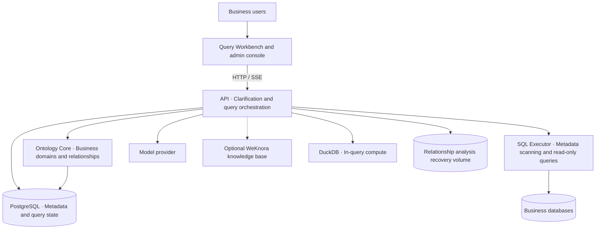
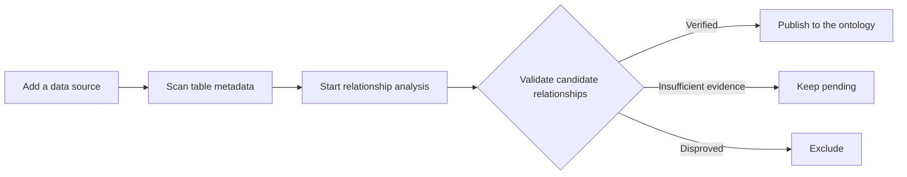
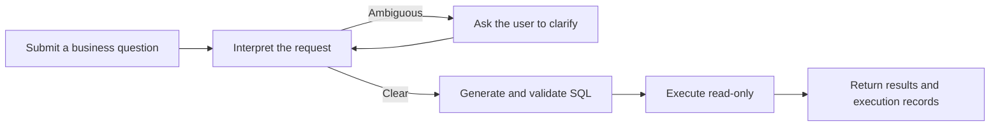

# Semora

**A self-hosted natural-language analytics workbench for relational data.**

English · [简体中文](README.zh-CN.md) · [Quickstart](#quickstart) · [Demo](docs/DEMO.md)

Ask Semora a business question. It uses the tables, fields, and relationships in a business domain to interpret the request, asks for clarification when needed, and runs read-only SQL. The workbench shows the results, the SQL, and an execution record.

## Features

- **Turn database schema into a business model.** Scan tables, columns, keys, and comments, then run relationship analysis on demand. Review proposed joins, including composite keys, cardinality, and join conditions, before using them in reusable business domains.
- **Resolve business ambiguity before it becomes a SQL error.** Interpret requests against the domain model and, when connected, WeKnora business knowledge. If choices such as date range, grouping, or metric definition would change the answer, Semora asks the user to clarify and continues with the confirmed scope.
- **Validate SQL before hitting the database.** Check table references and SQL structure against the selected domain, compile for the target dialect, and run an `EXPLAIN` preflight where supported. Read-only execution is bounded by configurable timeouts and result limits.
- **Query across data sources in a single request.** Execute steps against their respective sources, pass intermediate keys between steps, and use DuckDB to join or aggregate the intermediate results within the query.
- **Trace the answer back to the query.** Inspect the interpreted requirements, returned rows, SQL, and execution record in the workbench. See which step failed when a query cannot finish.

## System architecture



The web console uses Vue 3, TypeScript, and TDesign. FastAPI and LangGraph orchestrate queries, with SQLGlot for validation and dialect conversion. The Go ontology service manages business domains, and a Python executor with a Java JDBC worker accesses databases. The default stack uses PostgreSQL for query history and LangGraph checkpoints. Relationship analysis recovery files have their own volume.

## Quickstart

### 1. Start Semora

Requires Docker Engine or Docker Desktop with Docker Compose v2.

```sh
git clone https://github.com/aikernix/semora-community.git
cd semora-community
cp .env.example .env
docker compose -f docker-compose.yml -f deploy/compose.mvp.yml up -d --build web
```

Open the [workbench](http://127.0.0.1:5173) and configure an OpenAI-compatible model under **System Settings** (系统设置). Compose runs the database migrations automatically. [API docs](http://127.0.0.1:8000/docs) · [Health check](http://127.0.0.1:8000/healthz)

### 2. Load and bind the demo data

Load synthetic orders into a separate schema in the local PostgreSQL container.

```sh
docker compose -f docker-compose.yml -f deploy/compose.mvp.yml exec -T postgres \
  psql -v ON_ERROR_STOP=1 -U semora -d semora_business < examples/sales_demo.sql
```

Add a PostgreSQL data source. These credentials are for the default local Compose stack.

| Field | Value |
| --- | --- |
| Name | Sales Demo |
| Host and port | `postgres:5432` |
| Database | `semora_business` |
| Username and password | Both `semora_reader` |
| Schema under advanced settings | `semora_sales_demo` |

Test the connection, create the source, and wait for schema scanning to finish. Click **Reanalyze Relationships** (重新分析关联关系). In **Ontology Studio** (本体工作室), create a business domain named **Sales Analytics** with ID `sales_demo` and bind **Sales Demo**.

### 3. Ask a question

Select **Sales Analytics** in the query workbench. Start a new query, name it **October sales by channel**, and enter:

> For completed orders in October 2026, show total paid amount in CNY and order count by sales channel, sorted by paid amount descending.

Expected results are **Online: 218.00 CNY, 2 orders**, **Retail: 149.00 CNY, 1 order**, and **Partner: 75.00 CNY, 1 order**. The cancelled order and the November order are excluded. Open **Execution Record** to inspect the SQL.

## Workflows

### Schema scanning and relationship analysis



### Natural-language queries



## Database connectivity

| Connection path | Included connectors |
| --- | --- |
| Native PostgreSQL protocol | PostgreSQL |
| Native MySQL protocol | MySQL, GoldenDB |
| Bundled JDBC drivers | Oracle, SQL Server, OceanBase, Vastbase |
| Custom JDBC | Administrator-supplied drivers |

Driver availability and validated query support vary by target database. SQL Server is bundled in the executor and is currently hidden in the create-source dialog. For custom JDBC, query execution requires a supported dialect and a verified read-only strategy.

## Source layout

| Path | What to find there |
| --- | --- |
| [`apps/web`](apps/web) | Web interface and browser tests |
| [`services/api`](services/api) | API, query workflow, metadata modeling, and SQL compilation |
| [`services/agent`](services/agent) | Agent runtime and model integration |
| [`services/ontology`](services/ontology) | Ontology service |
| [`services/executor`](services/executor) | Native adapters and JDBC worker |
| [`packages/contracts`](packages/contracts) | Shared request, workflow, and SQL plan models |
| [`deploy`](deploy) | Compose overlays and database migrations |

## Development checks

```sh
python -m pip install -r services/api/requirements.txt -r services/executor/requirements.txt pytest
python -m pytest services/api/tests

cd apps/web
npm ci
npm run build
npm run test:e2e
```

Browser tests use the local console by default. Set `SEMORA_WEB_URL` to select a running test instance.

## License

Semora is distributed under the [MIT License](LICENSE). See [Third-party notices](THIRD_PARTY_NOTICES.md) for dependency and bundled driver licenses.

See the [contribution terms](CONTRIBUTING.md) for licensing and attribution of pull requests and the [name and logo policy](TRADEMARKS.md) for use of the Semora identity.
