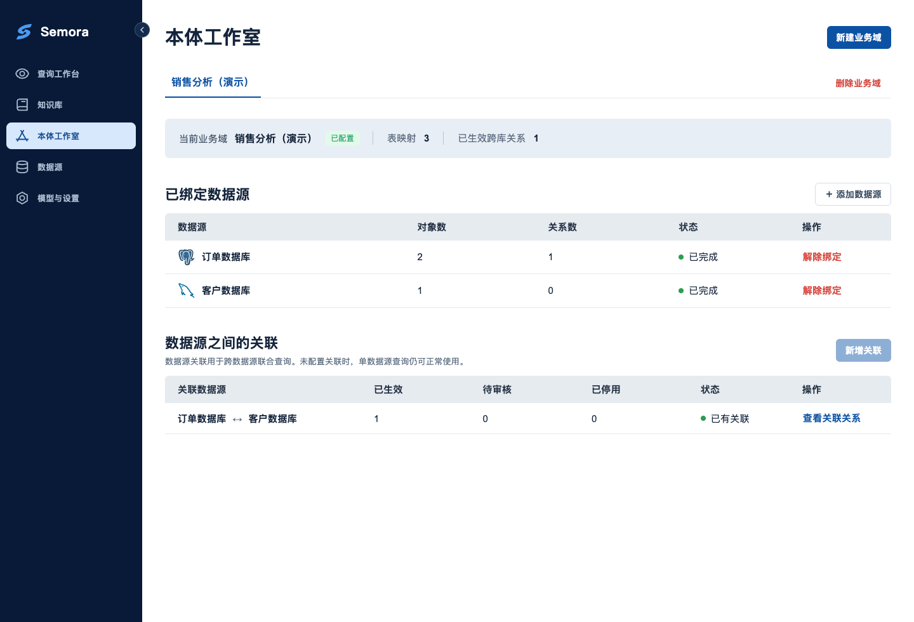
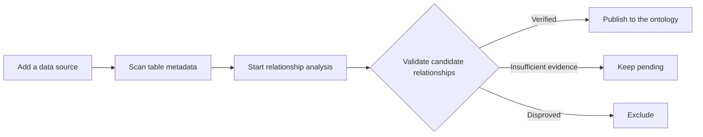
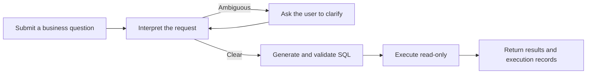

# Semora

**Ontology-grounded analytics for relational data.**

English · [简体中文](README.zh-CN.md)

Semora turns business questions into read-only SQL and verifiable results. It scans database metadata, discovers candidate relationships, and organizes approved mappings into business domains. At query time, it loads relevant context, asks for clarification when the business meaning is ambiguous, and validates generated SQL before execution.

## Screenshots

The screenshots use synthetic data.




## Quick start

Requires Docker Engine or Docker Desktop with Docker Compose v2. Run these commands from the repository root.

```sh
cp .env.example .env
docker compose -f docker-compose.yml -f deploy/compose.mvp.yml up -d --build web
```

| Service | Local address |
| --- | --- |
| Web console | <http://127.0.0.1:5173> |
| API documentation | <http://127.0.0.1:8000/docs> |
| API health | <http://127.0.0.1:8000/healthz> |

1. Configure an OpenAI-compatible model in **System Settings**.
2. Add a database connection and let the initial table scan finish. Start relationship analysis explicitly.
3. Create a business domain and bind the modeled source. Optionally connect WeKnora and bind a knowledge base.
4. Open the query workbench, select the domain, and submit a business question.

The default stack runs Web, API, Ontology Core, SQL Executor, and PostgreSQL. Compose runs database migrations as one-off jobs. On Windows, you can also use [`scripts/start-mvp.ps1`](scripts/start-mvp.ps1).

## Workflows

### Schema scanning and relationship analysis



### Natural-language queries



## Architecture and stack

| Component | Stack and role |
| --- | --- |
| Web | Vue 3, TypeScript, and TDesign for the query workbench and administration |
| API | FastAPI and LangGraph for query orchestration and streaming |
| Ontology | Go and PostgreSQL for business domains and data-source relationships |
| SQL execution | Python, SQLGlot, and a Java JDBC worker for dialect conversion and read-only execution |
| Local query compute | DuckDB for processing intermediate results |

Model providers and the optional WeKnora knowledge service are external integrations.

## Database connectivity

Semora connects to data sources over native PostgreSQL and MySQL protocols and through JDBC. Query capabilities depend on driver configuration and validation against the target database.

## License

Semora is distributed under the [MIT License](LICENSE). See [Third-party notices](THIRD_PARTY_NOTICES.md) for dependency and bundled driver licenses.

See the [contribution terms](CONTRIBUTING.md) for licensing and attribution of pull requests and the [name and logo policy](TRADEMARKS.md) for use of the Semora identity.
