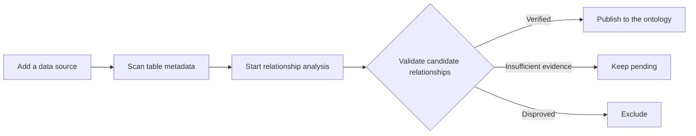
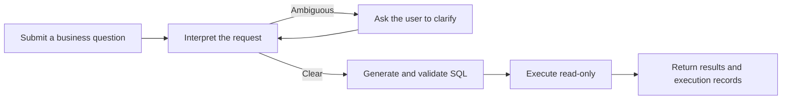
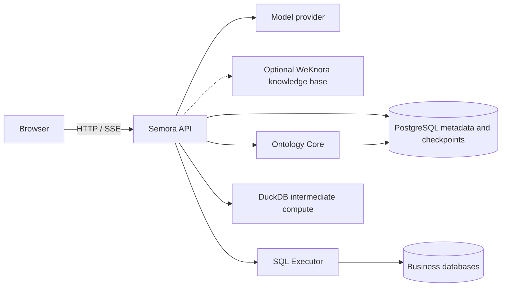

# Semora

**Ontology-grounded analytics for relational data.**

English · [简体中文](README.zh-CN.md)

Semora turns business questions into read-only SQL and verifiable results. It scans database metadata, discovers candidate relationships, and organizes approved mappings into business domains. At query time, it loads relevant context, asks for clarification when the business meaning is ambiguous, and validates generated SQL before execution.

[View the Query Workbench demo](docs/DEMO.md)

## Quick start

Requires Docker Engine or Docker Desktop with Docker Compose v2. Run these commands from the repository root.

```sh
cp .env.example .env
docker compose -f docker-compose.yml -f deploy/compose.mvp.yml up -d --build web
```

| Service | Local address |
| --- | --- |
| Web console | <http://127.0.0.1:5173> |
| API documentation | <http://127.0.0.1:8000/docs> |
| API health | <http://127.0.0.1:8000/healthz> |

1. Configure an OpenAI-compatible model in **System Settings**.
2. Add a database connection and let the initial table scan finish. Start relationship analysis explicitly.
3. Create a business domain and bind the modeled source. Optionally connect WeKnora and bind a knowledge base.
4. Open the query workbench, select the domain, and submit a business question.

The default stack runs Web, API, Ontology Core, SQL Executor, and PostgreSQL. Compose runs database migrations as one-off jobs. On Windows, you can also use [`scripts/start-mvp.ps1`](scripts/start-mvp.ps1).

## Workflows

### Schema scanning and relationship analysis



### Natural-language queries



## System architecture



| Component | Stack and responsibility |
| --- | --- |
| Web console | Vue 3, TypeScript, and TDesign. Provides the query workbench and manages data sources, business domains, and system settings. |
| API and query runtime | FastAPI, LangGraph, and SQLGlot. Orchestrates clarification, query planning, SQL validation and dialect conversion, and streams progress to the browser. |
| Ontology Core | Go and PostgreSQL. Manages business domains, table and field mappings, relationships, and published configurations. |
| SQL Executor | Python clients and a Java JDBC worker. Reads database metadata, validates capabilities, and runs read-only queries under execution limits. |
| Intermediate compute | DuckDB. Processes intermediate results within a query, including multi-source joins and aggregation. |
| Application state | PostgreSQL. Stores metadata, query records, and workflow checkpoints. |

## Query execution and controls

- **Context and scope.** The selected business domain determines the data sources, objects, and relationships available to the query. An optional knowledge base can supply business definitions. If a question is ambiguous, the workbench asks the user to clarify.
- **Validation and execution.** Query plans specify source and local computation steps. The API checks SQL structure and table references, compiles queries for the target dialect, and uses `EXPLAIN` when supported. The executor applies the target connector's read-only controls.
- **Limits and observability.** Administrators can set per-statement and preflight timeouts separately from result limits. Defaults are 30 seconds per SQL statement, 30 seconds per preflight, 1,000 rows, and 10 MiB. Results are accompanied by SQL and an execution record.

## Database connectivity

| Connection path | Included connectors |
| --- | --- |
| Native PostgreSQL protocol | PostgreSQL |
| Native MySQL protocol | MySQL, GoldenDB |
| Bundled JDBC drivers | Oracle, SQL Server, OceanBase, Vastbase |
| Custom JDBC | Administrator-supplied drivers |

Driver availability and validated query support vary by target database. SQL Server is bundled in the executor and is currently hidden in the create-source dialog. For custom JDBC, query execution requires a supported dialect and a verified read-only strategy.

## Source layout

| Path | What to find there |
| --- | --- |
| [`apps/web`](apps/web) | Web interface and browser tests |
| [`services/api`](services/api) | API, query workflow, metadata modeling, and SQL compilation |
| [`services/agent`](services/agent) | Agent runtime and model integration |
| [`services/ontology`](services/ontology) | Ontology service |
| [`services/executor`](services/executor) | Native adapters and JDBC worker |
| [`packages/contracts`](packages/contracts) | Shared request, workflow, and SQL plan models |
| [`deploy`](deploy) | Compose overlays and database migrations |

## Development checks

```sh
python -m pip install -r services/api/requirements.txt -r services/executor/requirements.txt pytest
python -m pytest services/api/tests

cd apps/web
npm ci
npm run build
npm run test:e2e
```

Browser tests use the local console by default. Set `SEMORA_WEB_URL` to select a running test instance.

## License

Semora is distributed under the [MIT License](LICENSE). See [Third-party notices](THIRD_PARTY_NOTICES.md) for dependency and bundled driver licenses.

See the [contribution terms](CONTRIBUTING.md) for licensing and attribution of pull requests and the [name and logo policy](TRADEMARKS.md) for use of the Semora identity.
