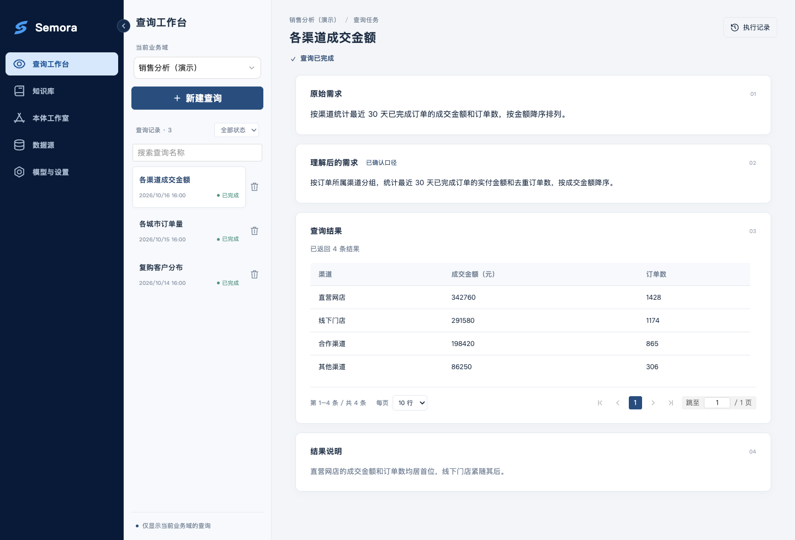
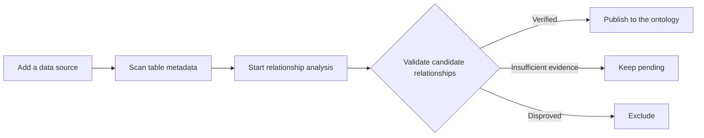
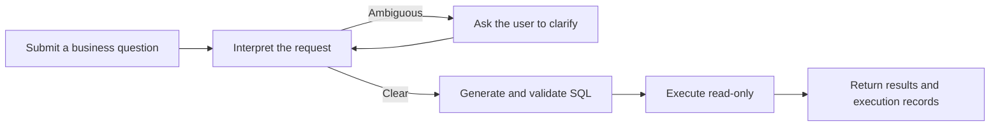

# Semora

**Ontology-grounded analytics for relational data.**

English · [简体中文](README.zh-CN.md)

Semora helps teams query relational data in natural language. It organizes data sources into business domains, clarifies ambiguous requests, and returns read-only query results with SQL and execution records.

This repository contains a product preview and a runnable example with synthetic data. The Semora application and services are maintained privately.

## Screenshots

The screenshots use synthetic data.




## Run the example

Run this standalone SQL example with Python 3. It uses synthetic orders to calculate revenue and order count by channel, without requiring a database service, model, or API key.

```sh
python3 examples/sales_summary.py
```

## Workflows

### Schema scanning and relationship analysis



### Natural-language queries



## License

The materials published in this repository are available under the [MIT License](LICENSE).

See the [contribution terms](CONTRIBUTING.md) for licensing and attribution of pull requests and the [name and logo policy](TRADEMARKS.md) for use of the Semora identity.
