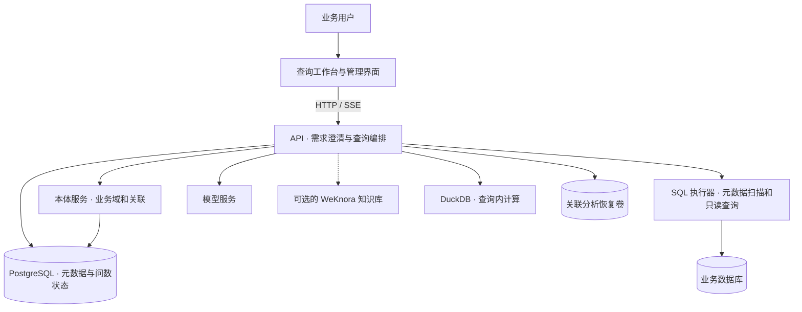
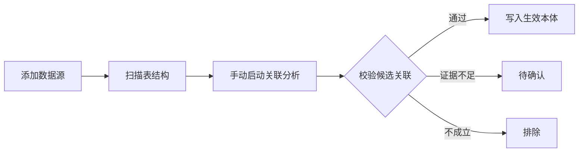
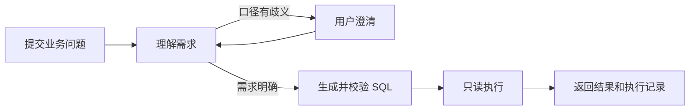

# Semora

**可自托管的自然语言问数工作台，面向关系型数据库。**

[English](README.md) · 简体中文 · [快速启动](#快速启动) · [界面演示](docs/DEMO.md)

把业务问题交给 Semora，它会结合业务域中的表、字段和关联理解需求，必要时请用户确认口径，再生成并执行只读 SQL。用户可以查看结果、执行的 SQL 和查询记录。

## 核心能力

- **从表结构建立业务域。** 扫描数据库元数据，按需运行关联分析，将可用的表、字段和关系组织成业务域。
- **先明确口径，再查询。** 根据本体和可选的 WeKnora 知识检索理解术语，在业务口径存在歧义时暂停并询问。
- **校验并执行 SQL。** 按目标数据库方言生成 SQL，执行前校验，受限只读执行后交付结果与记录。跨源计划可在步骤间传递中间结果。

## 系统架构



Web 使用 Vue 3、TypeScript 和 TDesign。API 使用 FastAPI 与 LangGraph 编排流程，SQLGlot 负责 SQL 校验和方言转换。Go 本体服务管理业务域，Python 执行器与 Java JDBC Worker 负责访问业务库。默认部署使用 PostgreSQL 保存查询历史和 LangGraph 检查点，关联分析的恢复文件另存于独立卷。

## 快速启动

### 1. 启动服务

需要 Docker Engine 或 Docker Desktop，以及 Docker Compose v2。

```sh
git clone https://github.com/aikernix/semora-community.git
cd semora-community
cp .env.example .env
docker compose -f docker-compose.yml -f deploy/compose.mvp.yml up -d --build web
```

打开 [Web 工作台](http://127.0.0.1:5173)，在「系统设置」配置兼容 OpenAI 接口的模型。Compose 会自动执行数据库迁移。[API 文档](http://127.0.0.1:8000/docs) · [健康检查](http://127.0.0.1:8000/healthz)

### 2. 导入并绑定示例数据

以下命令把合成订单写入本地 PostgreSQL 的独立 Schema。

```sh
docker compose -f docker-compose.yml -f deploy/compose.mvp.yml exec -T postgres \
  psql -v ON_ERROR_STOP=1 -U semora -d semora_business < examples/sales_demo.sql
```

在「数据源」添加 PostgreSQL。以下账号仅用于默认本地 Compose 环境。

| 字段 | 示例值 |
| --- | --- |
| 名称 | Sales Demo |
| 数据库地址和端口 | `postgres:5432` |
| 数据库名 | `semora_business` |
| 用户名和密码 | 均为 `semora_reader` |
| Schema（高级连接配置） | `semora_sales_demo` |

测试连接后创建数据源。表结构扫描完成后，点击「重新分析关联关系」。随后在本体工作室创建业务域「销售分析」，标识填写 `sales_demo`，绑定 **Sales Demo**。

### 3. 提交问题

在查询工作台选择「销售分析」，新建查询，名称填写「十月渠道成交额」，需求填写：

> 按渠道汇总 2026 年 10 月已完成订单的成交金额（元）和订单数，按成交金额降序排列。

预期结果为 **Online 218.00 元／2 单、Retail 149.00 元／1 单、Partner 75.00 元／1 单**。取消订单和 11 月订单不会计入。页面展示结果，可打开「执行记录」查看 SQL。

## 工作流程

### 表结构扫描与关联分析



### 自然语言查询



## 数据库接入

| 接入方式 | 已提供的适配 |
| --- | --- |
| 原生 PostgreSQL 协议 | PostgreSQL |
| 原生 MySQL 协议 | MySQL、GoldenDB |
| 内置 JDBC 驱动 | Oracle、SQL Server、OceanBase、Vastbase |
| 自定义 JDBC | 管理员提供的驱动 |

驱动可用性与查询能力以目标数据库验证为准。SQL Server 驱动随执行器分发，目前未在新增数据源下拉列表中展示。自定义 JDBC 需要受支持的方言和经过验证的只读策略，才能执行查询。

## 源码目录

| 路径 | 内容 |
| --- | --- |
| [`apps/web`](apps/web) | 前端和浏览器测试 |
| [`services/api`](services/api) | API、查询流程、元数据建模与 SQL 编译 |
| [`services/agent`](services/agent) | 智能体运行时和模型集成 |
| [`services/ontology`](services/ontology) | 本体服务 |
| [`services/executor`](services/executor) | 原生数据库适配和 JDBC Worker |
| [`packages/contracts`](packages/contracts) | 公共请求、流程状态和 SQL 计划模型 |
| [`deploy`](deploy) | Compose 配置和数据库迁移 |

## 开发验证

```sh
python -m pip install -r services/api/requirements.txt -r services/executor/requirements.txt pytest
python -m pytest services/api/tests

cd apps/web
npm ci
npm run build
npm run test:e2e
```

浏览器测试默认连接本地控制台，可用 `SEMORA_WEB_URL` 指定运行中的测试实例。

## 许可证

Semora 采用 [MIT 许可证](LICENSE)。依赖库及内置驱动的许可见 [第三方声明](THIRD_PARTY_NOTICES.md)。

PR 的授权和署名规则见 [贡献指南](CONTRIBUTING.md)。Semora 名称和标识的使用说明见 [品牌声明](TRADEMARKS.md)。
