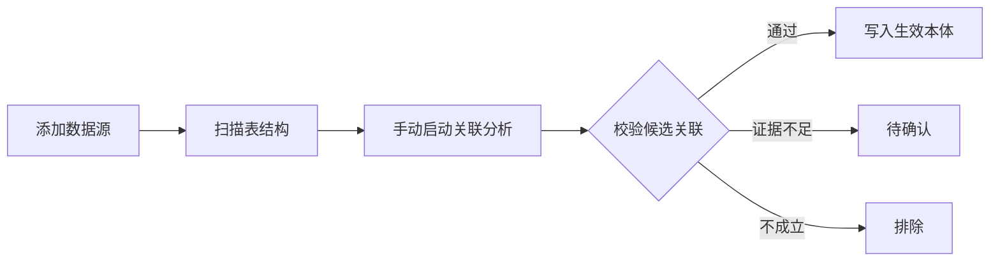
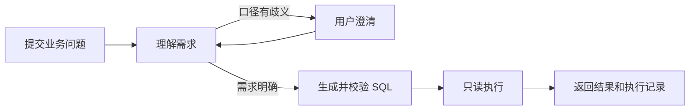

# Semora

**以本体为语义基础的关系型数据分析平台**

[English](README.md) · 简体中文

Semora 帮助团队用自然语言查询关系型数据。它将数据源组织成业务域，在需要时澄清业务口径，并交付只读查询结果、SQL 和执行记录。

本仓库提供产品预览和可运行的合成数据示例。Semora 服务和应用源码保存在私有仓库。

## 界面预览

以下截图使用合成数据。


## 运行示例

使用 Python 3 运行一个独立的 SQL 示例，无需数据库服务、模型或 API Key。示例用合成订单数据演示如何按渠道汇总成交金额和订单数。

```sh
python3 examples/sales_summary.py
```

## 工作流程

### 表结构扫描与关联分析



### 自然语言查询



## 许可证

本仓库公开的内容采用 [MIT 许可证](LICENSE)。

PR 的授权和署名规则见 [贡献指南](CONTRIBUTING.md)。Semora 名称和标识的使用说明见 [品牌声明](TRADEMARKS.md)。
