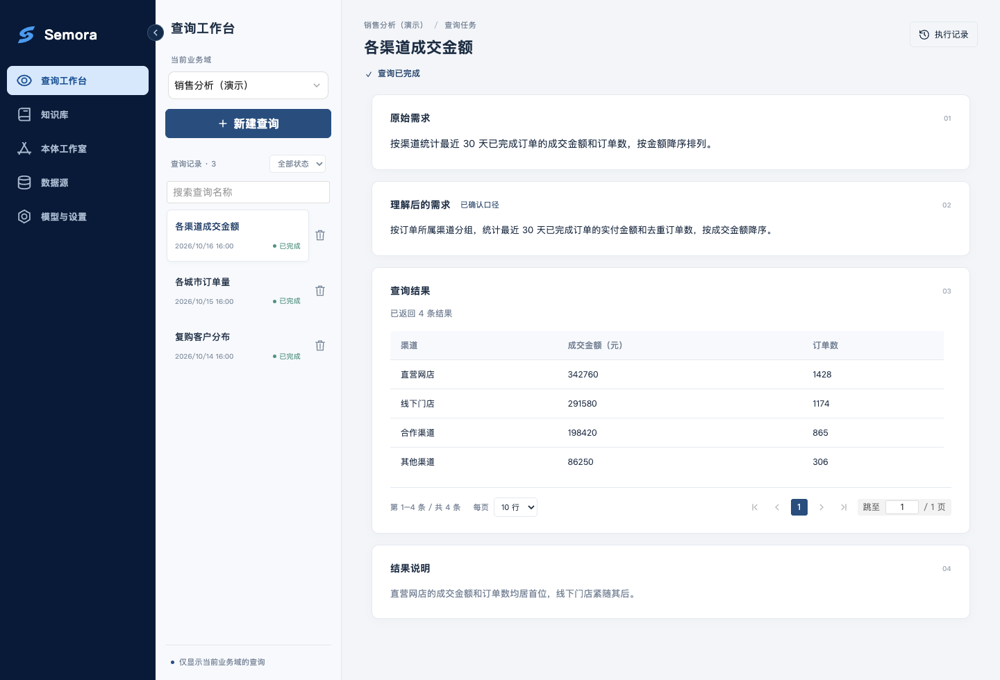
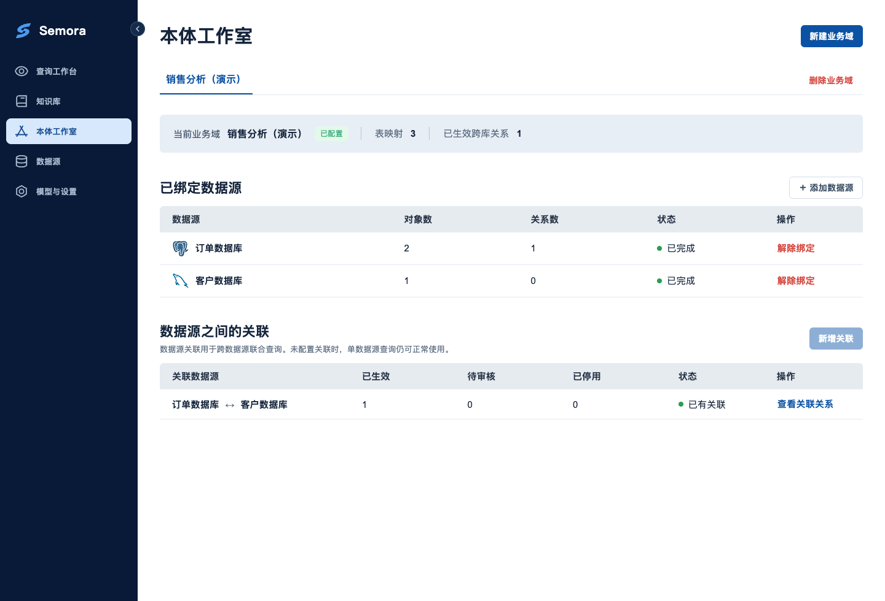
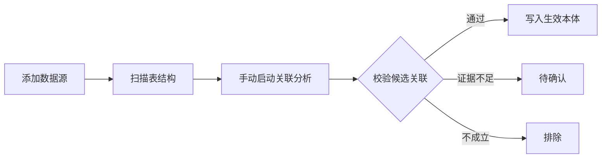
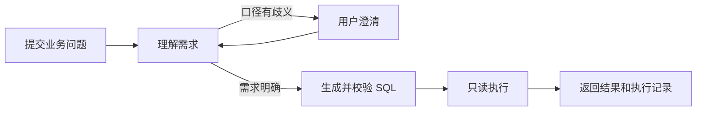

# Semora

**以本体为语义基础的关系型数据分析平台**

[English](README.md) · 简体中文

Semora 将自然语言业务问题转成只读 SQL 和可核查的结果。系统扫描数据库元数据、发现候选关系，并将确认后的映射组织成业务域。查询时，系统按需加载相关资料，在业务口径有歧义时向用户澄清，并在执行前校验生成的 SQL。

## 界面预览

以下截图使用合成数据。





## 快速启动

需要 Docker Engine 或 Docker Desktop，以及 Docker Compose v2。在仓库根目录执行：

```sh
cp .env.example .env
docker compose -f docker-compose.yml -f deploy/compose.mvp.yml up -d --build web
```

| 服务 | 本地地址 |
| --- | --- |
| Web 控制台 | <http://127.0.0.1:5173> |
| API 文档 | <http://127.0.0.1:8000/docs> |
| API 健康检查 | <http://127.0.0.1:8000/healthz> |

1. 在 **系统设置** 中配置兼容 OpenAI 接口的模型。
2. 添加数据库连接，等待首次表结构扫描完成，再手动启动关联分析。
3. 创建业务域并绑定已建模的数据源。可按需接入 WeKnora 并绑定知识库。
4. 打开查询工作台，选择业务域并提交业务问题。

默认运行 Web、API、Ontology Core、SQL Executor 和 PostgreSQL。Compose 将数据库迁移作为一次性任务执行。Windows 用户也可以使用 [`scripts/start-mvp.ps1`](scripts/start-mvp.ps1)。

## 工作流程

### 表结构扫描与关联分析



### 自然语言查询



## 架构与技术栈

| 组件 | 技术栈与职责 |
| --- | --- |
| Web | Vue 3、TypeScript、TDesign，提供查询工作台和管理界面 |
| API | FastAPI、LangGraph，负责问数流程和流式响应 |
| 本体服务 | Go、PostgreSQL，管理业务域及数据源关系 |
| SQL 执行器 | Python、SQLGlot、Java JDBC，负责方言转换和只读执行 |
| 查询内计算 | DuckDB，用于处理中间结果 |

模型服务与可选的 WeKnora 知识库通过外部接口接入。

## 数据库接入

Semora 通过原生 PostgreSQL 和 MySQL 协议及 JDBC 连接数据源。内置驱动和自定义 JDBC 的查询能力以目标实例验证为准。

## 许可证

Semora 采用 [MIT 许可证](LICENSE)。依赖库及内置驱动的许可见 [第三方声明](THIRD_PARTY_NOTICES.md)。

PR 的授权和署名规则见 [贡献指南](CONTRIBUTING.md)。Semora 名称和标识的使用说明见 [品牌声明](TRADEMARKS.md)。
