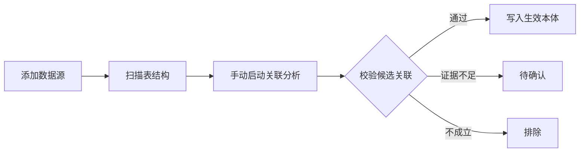
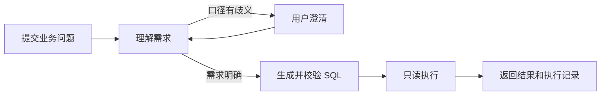
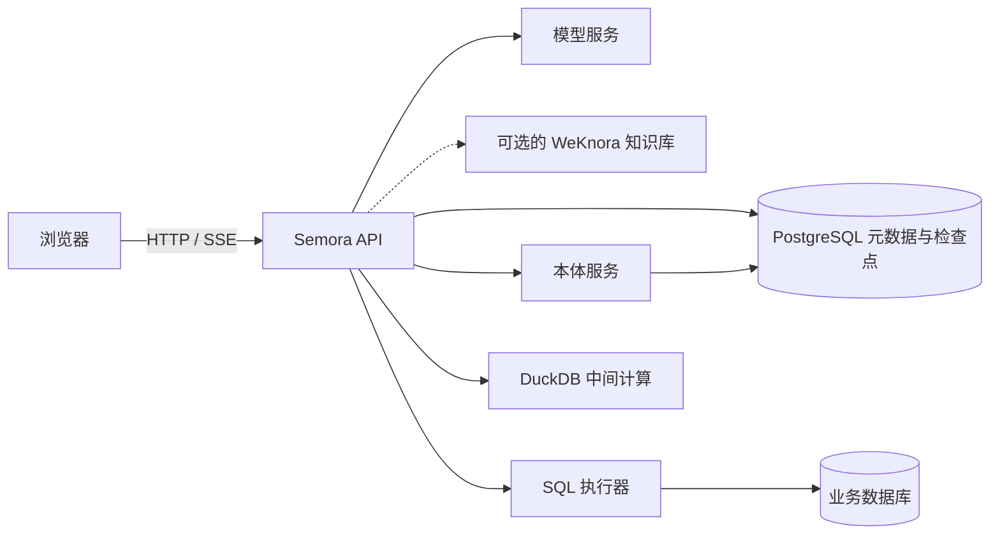

# Semora

**以本体为语义基础的关系型数据分析平台**

[English](README.md) · 简体中文

Semora 将自然语言业务问题转成只读 SQL 和可核查的结果。系统扫描数据库元数据、发现候选关系，并将确认后的映射组织成业务域。查询时，系统按需加载相关资料，在业务口径有歧义时向用户澄清，并在执行前校验生成的 SQL。

[查看查询工作台演示](docs/DEMO.md)

## 快速启动

需要 Docker Engine 或 Docker Desktop，以及 Docker Compose v2。在仓库根目录执行：

```sh
cp .env.example .env
docker compose -f docker-compose.yml -f deploy/compose.mvp.yml up -d --build web
```

| 服务 | 本地地址 |
| --- | --- |
| Web 控制台 | <http://127.0.0.1:5173> |
| API 文档 | <http://127.0.0.1:8000/docs> |
| API 健康检查 | <http://127.0.0.1:8000/healthz> |

1. 在 **系统设置** 中配置兼容 OpenAI 接口的模型。
2. 添加数据库连接，等待首次表结构扫描完成，再手动启动关联分析。
3. 创建业务域并绑定已建模的数据源。可按需接入 WeKnora 并绑定知识库。
4. 打开查询工作台，选择业务域并提交业务问题。

默认运行 Web、API、Ontology Core、SQL Executor 和 PostgreSQL。Compose 将数据库迁移作为一次性任务执行。Windows 用户也可以使用 [`scripts/start-mvp.ps1`](scripts/start-mvp.ps1)。

## 工作流程

### 表结构扫描与关联分析



### 自然语言查询



## 系统架构



| 组件 | 技术栈与职责 |
| --- | --- |
| Web 控制台 | Vue 3、TypeScript、TDesign，提供查询工作台及数据源、业务域和系统设置界面。 |
| API 与查询运行时 | FastAPI、LangGraph、SQLGlot，负责编排澄清与查询计划、校验 SQL、转换方言并流式返回进度。 |
| 本体服务 | Go、PostgreSQL，管理业务域、表与字段映射、关联关系和生效配置。 |
| SQL 执行器 | Python 客户端和 Java JDBC Worker，负责数据库元数据读取、能力验证和受限只读执行。 |
| 中间计算 | DuckDB，在单次查询内处理跨源关联、聚合等中间结果。 |
| 应用状态 | PostgreSQL，存储元数据、查询记录与流程检查点。 |

## 查询执行与边界

- **上下文与范围。** 当前业务域决定查询可用的数据源、对象与关系。知识库可补充业务定义，口径有歧义时工作台会向用户澄清。
- **校验与执行。** 查询计划区分数据源步骤和本地计算步骤。API 检查 SQL 结构和表引用，转换为目标方言，在目标库支持时使用 `EXPLAIN` 预检。执行器按对应适配器的只读策略执行。
- **限制与记录。** 管理员可分别配置单条 SQL 超时、预检超时、返回行数和数据量。默认值为 30 秒、30 秒、1,000 行和 10 MiB。查询结果附带 SQL 和执行记录。

## 数据库接入

| 接入方式 | 已提供的适配 |
| --- | --- |
| 原生 PostgreSQL 协议 | PostgreSQL |
| 原生 MySQL 协议 | MySQL、GoldenDB |
| 内置 JDBC 驱动 | Oracle、SQL Server、OceanBase、Vastbase |
| 自定义 JDBC | 管理员提供的驱动 |

驱动可用性与查询能力以目标数据库验证为准。SQL Server 驱动随执行器分发，目前未在新增数据源下拉列表中展示。自定义 JDBC 需要受支持的方言和经过验证的只读策略，才能执行查询。

## 源码目录

| 路径 | 内容 |
| --- | --- |
| [`apps/web`](apps/web) | 前端和浏览器测试 |
| [`services/api`](services/api) | API、查询流程、元数据建模与 SQL 编译 |
| [`services/agent`](services/agent) | 智能体运行时和模型集成 |
| [`services/ontology`](services/ontology) | 本体服务 |
| [`services/executor`](services/executor) | 原生数据库适配和 JDBC Worker |
| [`packages/contracts`](packages/contracts) | 公共请求、流程状态和 SQL 计划模型 |
| [`deploy`](deploy) | Compose 配置和数据库迁移 |

## 开发验证

```sh
python -m pip install -r services/api/requirements.txt -r services/executor/requirements.txt pytest
python -m pytest services/api/tests

cd apps/web
npm ci
npm run build
npm run test:e2e
```

浏览器测试默认连接本地控制台，可用 `SEMORA_WEB_URL` 指定运行中的测试实例。

## 许可证

Semora 采用 [MIT 许可证](LICENSE)。依赖库及内置驱动的许可见 [第三方声明](THIRD_PARTY_NOTICES.md)。

PR 的授权和署名规则见 [贡献指南](CONTRIBUTING.md)。Semora 名称和标识的使用说明见 [品牌声明](TRADEMARKS.md)。
