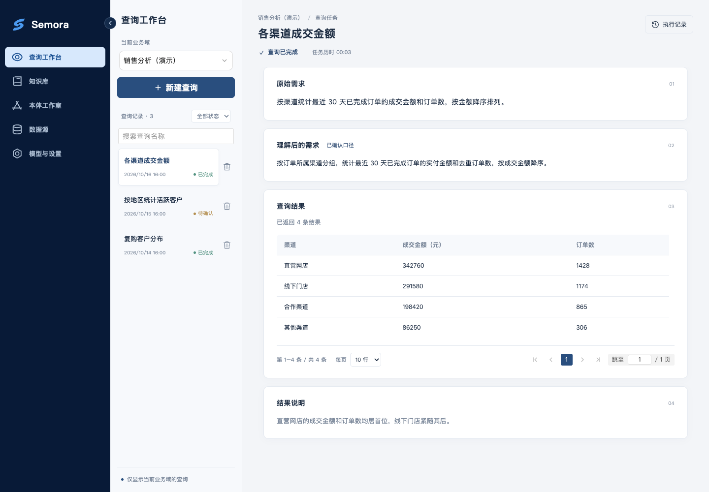
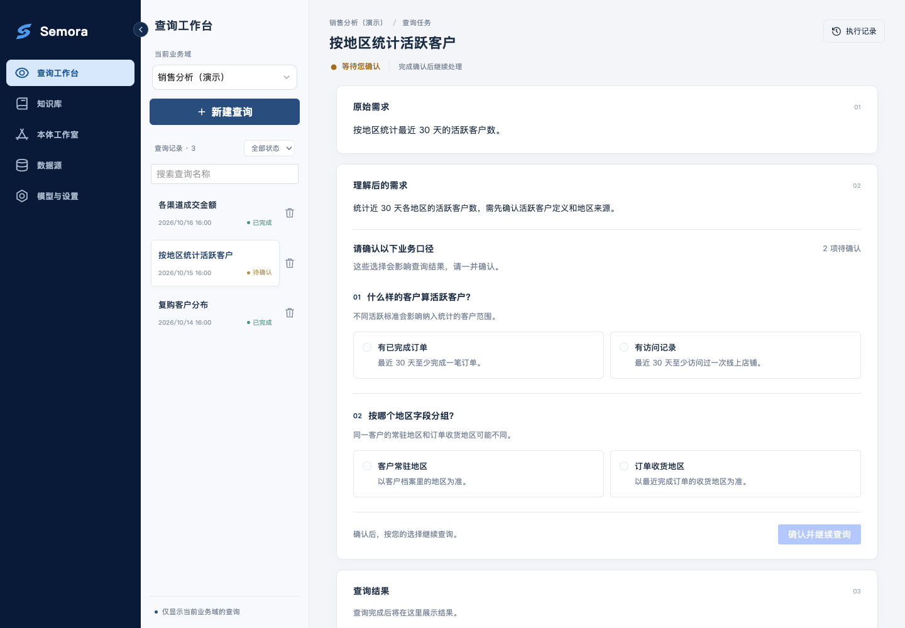
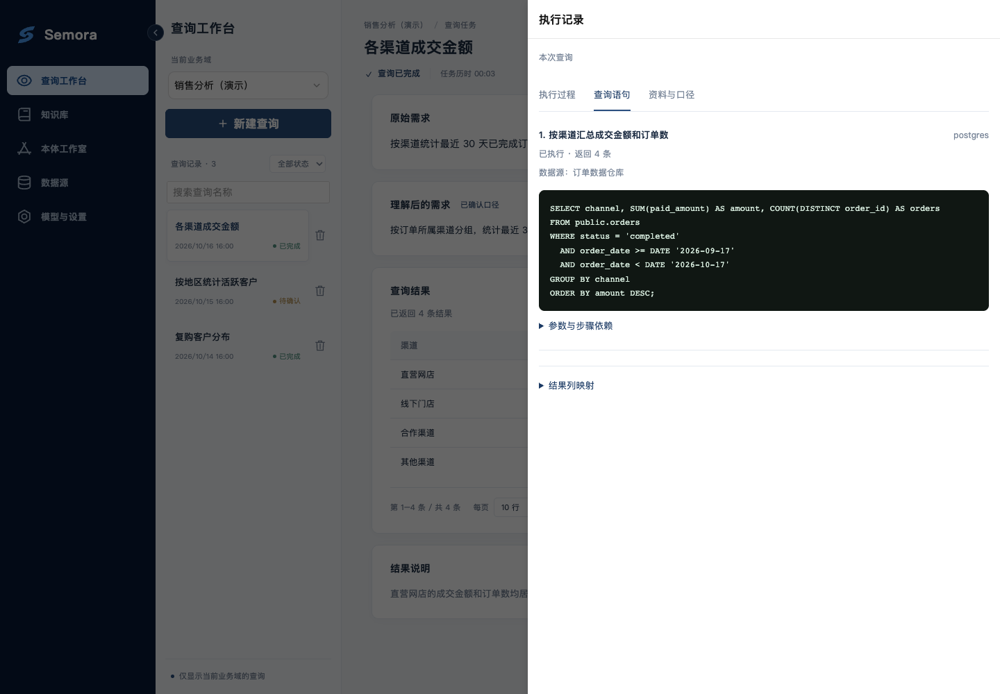
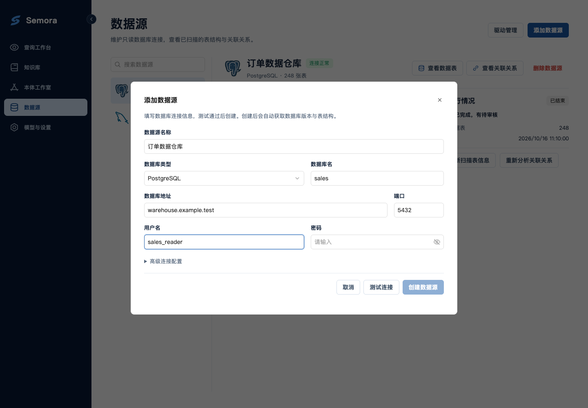
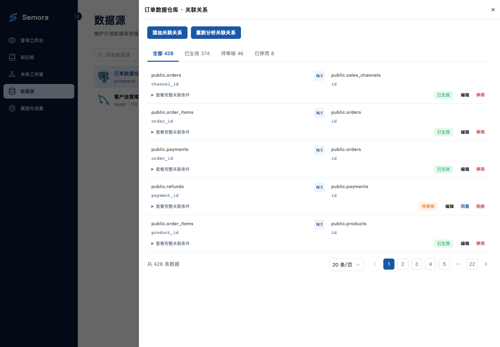
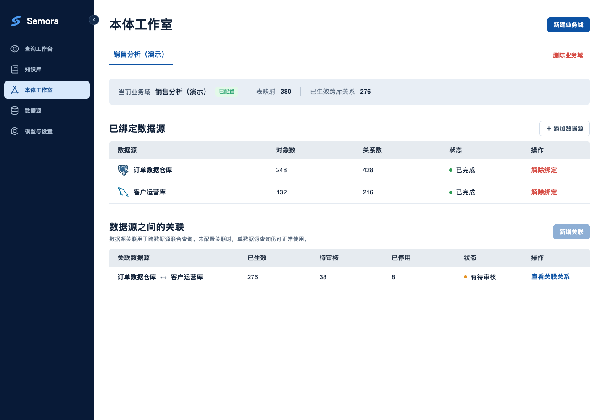

# Semora demo · 界面演示

[English README](../README.md) · [简体中文 README](../README.zh-CN.md)

All screenshots use synthetic data. The catalog and relationship counts are illustrative.

所有截图均使用合成数据。表数和关联数仅用于演示。

## Query Workbench · 查询工作台

View the original question, its interpreted requirements, and the results together. 在同一页查看原始需求、理解后的口径和查询结果。

### Clarification · 澄清业务口径

Confirm how to define an active customer and which region field to use. 查询前确认活跃客户的定义和地区分组字段。

### Execution record · 执行记录

Inspect the executed SQL and its result column mappings. 查看实际执行的 SQL 及结果列映射。

## Data sources · 数据源

### Connection setup · 数据源配置

Configure a database connection and test it before adding the source. 填写连接信息，测试通过后添加数据源。

### Relationship discovery · 自动关联分析

Run relationship analysis and review its results by status. 启动关联分析后，按状态查看已生效、待审核和已停用的关系。

## Ontology Studio · 本体工作室

Organize sources into a business domain and manage cross-source relationships. 演示业务域绑定两个数据源，共 380 个表映射，并展示跨源关联的状态与数量。

